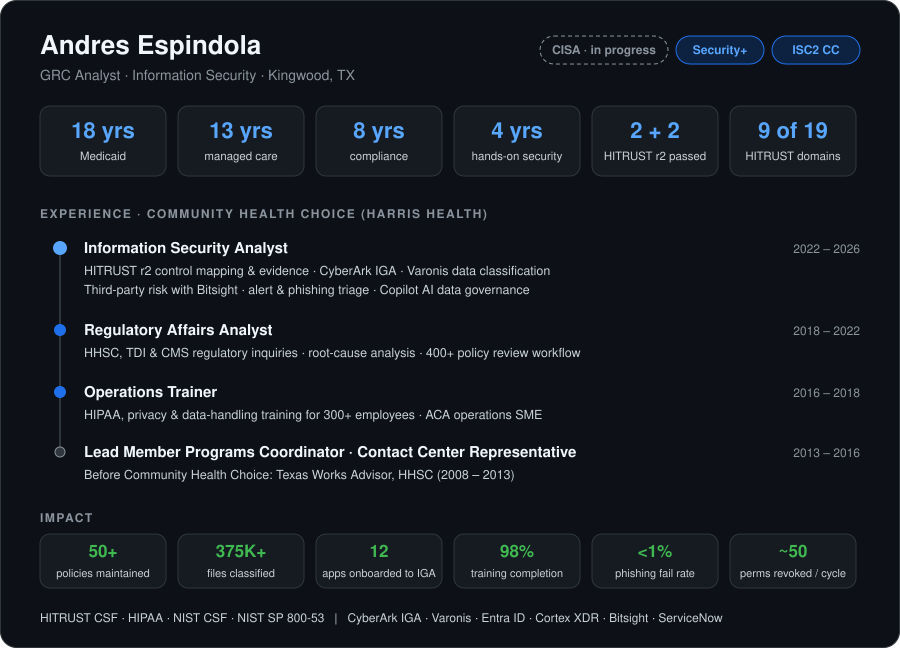

## Hi, I'm Andres Espindola 👋

Information Security Analyst, open to **GRC Analyst**, **Cybersecurity Compliance Analyst**, **Information Security Analyst**, **IAM Analyst**, or other cybersecurity role.

### Focus areas

- **Frameworks:** NIST CSF, HITRUST CSF
- **Risk management:** risk assessment, treatment and risk registers
- **Control mapping:** one control set mapped across multiple frameworks
- **Evidence collection:** audit readiness and continuous compliance
- **Compliance automation:** tools that cut repeat testing and manual tracking
- **Identity and access management:** provisioning, access reviews, MFA and least privilege
- **Data classification:** sensitivity levels, handling rules and data inventories

### Featured project

**[GRC Control Workbench](https://github.com/a-espindola/grc-control-workbench)** · [Live demo](https://a-espindola.github.io/grc-control-workbench/)

A single-page GRC application that maps 74 unified controls to 15 frameworks, so each control is tested once and counts toward every framework it satisfies. It includes a risk register with heat maps, findings and POA&Ms with CMMC SPRS scoring, vendor risk tracking, and policy review history. Built in vanilla JavaScript with no dependencies.

### Side projects

**[NIST SP 800-171 / CMMC Workspace](https://github.com/a-espindola/grc-800-171-demo)** · [Live demo](https://a-espindola.github.io/grc-800-171-demo/)

A practice workspace built around a single framework: the 110 NIST SP 800-171 requirements and 320 SP 800-171A assessment objectives, with CMMC Level 2 readiness checks, access reviews, asset scoping, and Word SSP export.

**[Vulnerability Management Workbench](https://github.com/a-espindola/vulnerability-management-workbench)** · [Live demo](https://a-espindola.github.io/vulnerability-management-workbench/)

A browser-based vulnerability management app covering the full lifecycle, from scan import to verified fix. It imports Nessus, CSV and CVE JSON records, enriches findings with CISA KEV and EPSS data, and ranks them with a transparent risk score. It also tracks remediation SLAs, runs a risk-acceptance workflow with separation of duties, and produces executive summaries and GRC evidence mapped to NIST 800-53 and 800-171.

### Certifications

- CompTIA Security+
- ISC2 Certified in Cybersecurity (CC)

### Connect

[LinkedIn](https://www.linkedin.com/in/andres-espindola-3b6723a3/)
